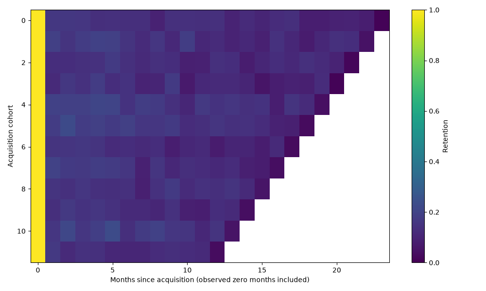
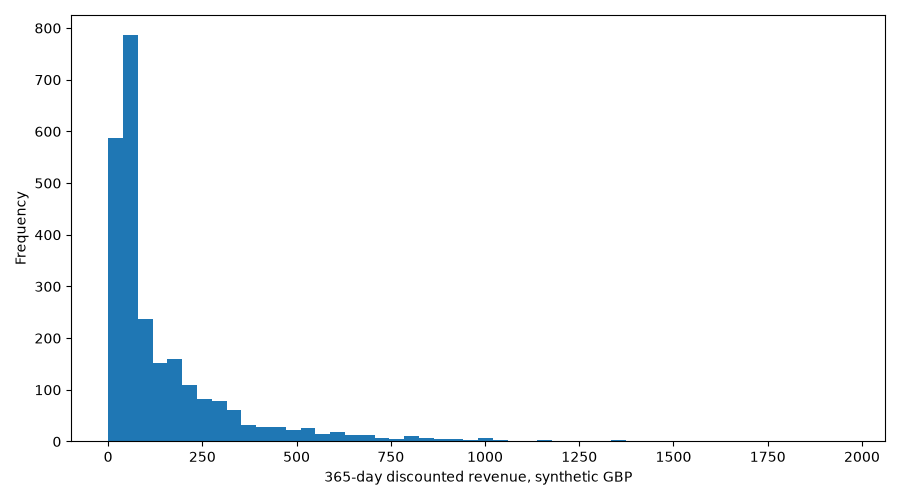

# Customer value: exact horizons and monetary holdouts

Executed 3 November 2026 on 2,500 synthetic customers. Currency values are generated GBP revenue, not profit, causal impact or campaign ROI.

## Forecast and retention conventions

The forecast sums daily expected purchase increments over days 1 through 365 inclusive. Monthly discount rate 1% means each day d is discounted by `(1.01)^(d/30)`. It never calls the lifetimes monthly CLV helper, which could extend a fractional-month horizon. Daily purchase counts, rather than invoice line items, are the count target.

Cohort retention includes observed months with no returning customers as zero. Future unobserved months remain missing. All channels use the same observation endpoint. Partial terminal months are included through the final observation date and should not be interpreted as complete-month estimates.

## Chronological validation

Three origins were specified before comparison: 1 March, 1 June and 1 September 2011, each followed by a nonoverlapping 90-day holdout. Each origin refits both BG/NBD and Gamma-Gamma using training records only. The same customers can occur at multiple origins, so origins are not independent samples. Holdout revenue is undiscounted realised transaction revenue, and is tested separately from purchase counts. New customers acquired after an origin are excluded.

For single-purchase customers, compare zero value, training population invoice-mean spend and shrinkage of individual invoice spend toward that mean with a fixed five-invoice prior. Repeat customers use Gamma-Gamma spend. The historical baseline uses observed daily purchase rate times 90 and customer mean invoice spend. Reporting uses the population fallback, specified before comparison; it is not selected as the holdout winner.

| Origin | Policy | Count MAE | Revenue MAE | Revenue bias | Revenue RMSE |
| --- | --- | --- | --- | --- | --- |
| 2011-03-01 | zero | 0.5471 | 56.1504 | -5.1450 | 122.7310 |
| 2011-03-01 | population | 0.5471 | 64.2949 | 6.8823 | 121.2198 |
| 2011-03-01 | shrinkage | 0.5471 | 65.9504 | 8.8161 | 121.4586 |
| 2011-03-01 | historical_rate_spend | 0.8492 | 129.0563 | 90.0762 | 211.6511 |
| 2011-06-01 | zero | 0.5052 | 52.0894 | -2.7590 | 109.1037 |
| 2011-06-01 | population | 0.5052 | 57.0265 | 4.2358 | 108.2183 |
| 2011-06-01 | shrinkage | 0.5052 | 58.2478 | 5.5981 | 108.2361 |
| 2011-06-01 | historical_rate_spend | 0.7051 | 97.9563 | 59.3728 | 147.5557 |
| 2011-09-01 | zero | 0.4696 | 51.0826 | -1.3018 | 102.7034 |
| 2011-09-01 | population | 0.4696 | 54.5293 | 3.3914 | 101.9257 |
| 2011-09-01 | shrinkage | 0.4696 | 55.4786 | 4.4702 | 101.9456 |
| 2011-09-01 | historical_rate_spend | 0.6373 | 85.9558 | 46.5835 | 128.3489 |

Zero-spend fallback has the lowest overall revenue MAE at all three origins. Population and shrinkage fallbacks reduce the single-purchase group's downward bias and RMSE, while increasing MAE. No fallback wins on every metric. All three BG/NBD-based forecasts outperform this historical-rate baseline on count MAE and overall revenue MAE in these synthetic windows. This is not evidence of accuracy on a real retailer.

`forecast_validation.csv` reports MAE, bias and RMSE for all customers, repeat and single-purchase customers, and all three acquisition channels. `holdout_predictions.csv` allows independent reconciliation. `forecast_diagnostics.json` reports training frequency/spend correlation: the generator couples frequency and spend, so Gamma-Gamma independence is questionable.

## Numerical reliability

The March fit exposed a lifetimes 0.11.3 numerical issue: its logarithm of a negative hypergeometric value returned missing predictions for single-purchase customers. The implementation now evaluates the signed expression directly and fails on nonfinite or negative predictions. Independent numerical integration verifies the expression in a regression test. Validation refuses missing predictions, preventing pandas means from silently excluding affected customers. Parameters with a near one fail explicitly pending a limit calculation.

## Final forecast

Final models are refitted through 9 December 2011 before forecasting days 1..365. The population-spend fallback uses this final training set only. See `clv_predictions.csv` and `run_summary.json` for values. These beyond-window values are not observed outcomes; the 90-day monetary holdouts do not directly validate an annual forecast.

## Reproduce

On Python 3.14: create `.venv`, install `requirements.txt`, run `.venv/Scripts/python.exe -m pytest tests -q -p no:cacheprovider`, then `.venv/Scripts/python.exe scripts/validate_forecasts.py` and `python scripts/generate_html_report.py`. The manifest records hashes, seeds, origins and package versions. Metrics allow absolute tolerance 1e-6 with pinned dependencies.

Campaign weighting remains an illustrative helper outside the main analysis. Incremental returns require treatment/control response data. Previous charts not referenced here are historical artifacts and do not describe this rerun; current report figures are retention_heatmap.png and clv_distribution.png.
