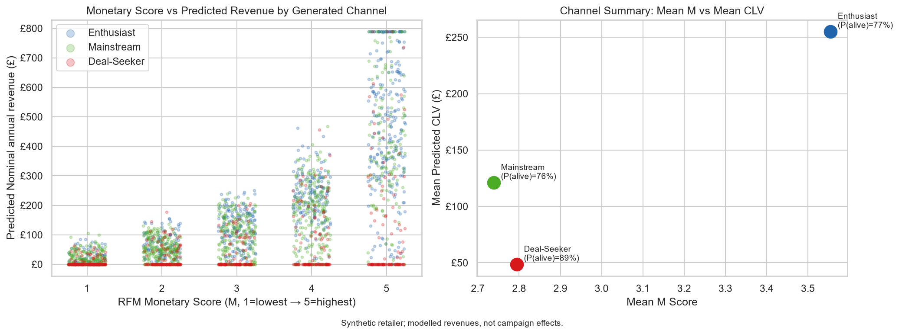
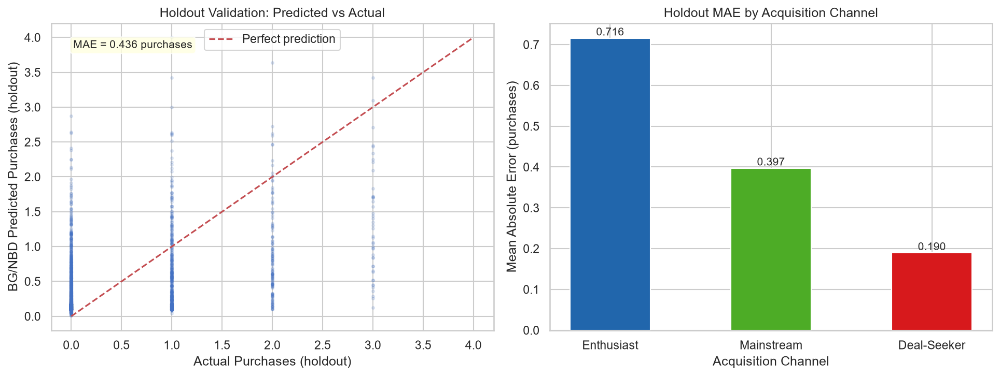
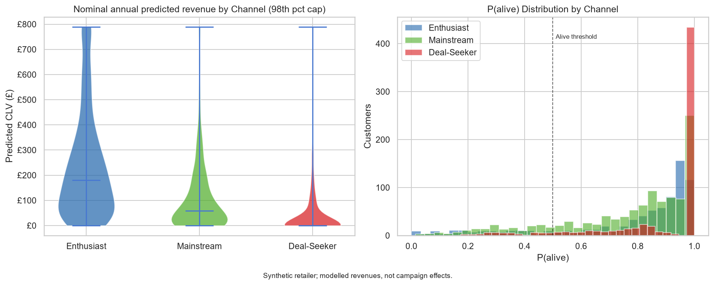

Thornbury & Co. is a fictional retailer scenario. I built a customer-analytics workflow using 2,500 generated customers, 9,632 invoices and 29,336 invoice line items. It includes RFM segmentation, cohort summaries, BG/NBD purchase predictions, a Gamma-Gamma spend model and a separate purchase-count holdout.

The data are synthetic, not a real retailer's transaction log. The GBP500,000 budget, contact cost and response rates are assumed scenario inputs. No campaign budget was managed and no campaign returns were observed.

## What the generator assumes

The generator assigns Enthusiast, Mainstream and Deal-Seeker labels, with different engagement distributions and parameters. A shared engagement variable drives purchase rates, basket sizes and dropout. This intentionally creates channel differences; the model does not discover causal effects of organic, search or flash-sale acquisition.

An optional UCI Online Retail II loader exists, but the executed notebook records that its input file was absent and uses synthetic seed 42. The named channel results therefore belong to the generated scenario.

## Historical customer summaries

RFM separates recency, purchase frequency and historical spend. In the saved notebook, Enthusiasts have the highest mean Monetary score, 3.55, compared with 2.79 for Deal-Seekers and 2.74 for Mainstream. Enthusiasts also have the highest predicted CLV. This run does not show a full inversion of the channel rankings.

Synthetic retailer scenario. The scatter compares different customer summaries, but it does not show the claimed full channel-rank inversion. Saved mean Monetary and predicted CLV both rank Enthusiasts highest.

The saved cohort implementation reports mean month-1 rates of 31.02%, 12.95% and 4.51% across Enthusiast, Mainstream and Deal-Seeker cohorts, against an assumed 20% floor. These are averages over available cohort cells. The current implementation omits months with no repeat purchasers instead of retaining observed zeros, so denominator handling needs correction before substantive interpretation. These are not measured acquisition or retention efficiencies.

## Fitted models and a chronological holdout

The notebook fits BG/NBD on records through 9 September 2011 and fits Gamma-Gamma on the 1,714 repeat customers in that calibration period. The following 91 days, through 9 December 2011, provide a separate purchase-count holdout. Saved holdout MAE is 0.4745 purchases per generated customer and signed bias is +0.0348.

Synthetic retailer scenario. The notebook reports full-population holdout MAE 0.4745 and bias +0.0348. This figure trims customers above the 98th percentile of actual holdout purchases before plotting and calculating its displayed diagnostics. Purchase-count validation does not validate campaign incrementality or future spend.

This time separation is an implemented validation achievement. It does not resolve every model assumption. The generator deliberately relates purchase frequency, spend and dropout through shared engagement, while standard BG/NBD and Gamma-Gamma specifications make independence assumptions about those quantities. Those assumptions need explicit checks and comparison with alternative models.

Final value estimates use histories through 9 December 2011 and forecast beyond that date, using parameters fitted earlier. They are distinct from the September-origin purchase-count holdout and do not have a saved monetary holdout validation.

## What the saved CLV estimates mean

The saved nominal annual discounted revenue estimates average GBP143, with median GBP63.25 and total GBP357,493.42. The smallest top group reaching 80% of predicted value contains 755 customers, or 30.2%. These are modelled discounted revenues, not margin-adjusted profit or realised sales.

The horizon conversion also needs correction: the wrapper passes 365/30 as monthly time, which the inspected lifetimes v0.11.3 helper expands into 13 monthly steps reaching 390 days. The exact historical dependency version is not recorded. These should remain nominal annual estimates until endpoint and discount conventions are reconciled in a new version.

Synthetic scenario estimates under the current implementation. Mean values are GBP255.26 for Enthusiast, GBP121.12 for Mainstream and GBP48.60 for Deal-Seeker. Channel differences are planted in the generator and affected by the treatment of single-purchase customers.

The implementation explicitly sets CLV to zero for customers without a repeat purchase. At the final scoring date this affects 684 customers. It is a chosen fallback policy, not a requirement that a single-purchase customer has no future value. BG/NBD can still predict positive future purchases for these records. A population-based spend or other cold-start treatment would need separate evaluation.

Model P(alive) is also distinct from the proportion of customers exceeding a cutoff. Deal-Seekers have mean model P(alive) near 0.89; 92.7% have individual P(alive) above 0.5. Neither number measures observed loyalty. In particular, BG/NBD's treatment of zero-repeat histories contributes to high survival probabilities.

## The campaign calculation needs a different target

The illustrative campaign function multiplies mean CLV by the share with P(alive) above 0.5 and by assumed response rates of 18%, 9% and 4%, then subtracts an assumed GBP3.50 contact cost. The resulting +10.0, +1.61 and -0.49 scores are not validated ROI.

CLV already integrates purchase survival through BG/NBD. Extra survival-related weighting can discount it again. More fundamentally, predicted customer revenue is not the incremental value caused by a campaign: there is no contacted-versus-uncontacted comparison, contribution-margin model or observed response effect.

The assumed GBP500,000 budget also exceeds the available one-contact population. Contacting all 2,500 generated customers once would cost GBP8,750. Contacting all Enthusiast and Mainstream records would cost GBP6,489 before eligibility filters. The notebook does not allocate a campaign budget. Incremental contribution, survival-based eligibility and contact treatment effects are not identified by this heuristic.

## What this project demonstrates

The supported contribution is an implemented workflow connecting generated transactions, customer summaries, fitted probabilistic models and a chronological purchase-count check. Auditing the complete chain also makes clear where a modelling convention or commercial assumption changes the story.

Further work would correct retention denominators, evaluate single-purchase value policies, diagnose model independence, validate future monetary outcomes and define incremental contribution from outreach. Any campaign allocation would then need explicit eligibility, contact limits, budget accounting and uncertainty. Until that work is executed and recorded, the saved campaign scores remain a hypothetical illustration rather than evidence of marketing returns.
